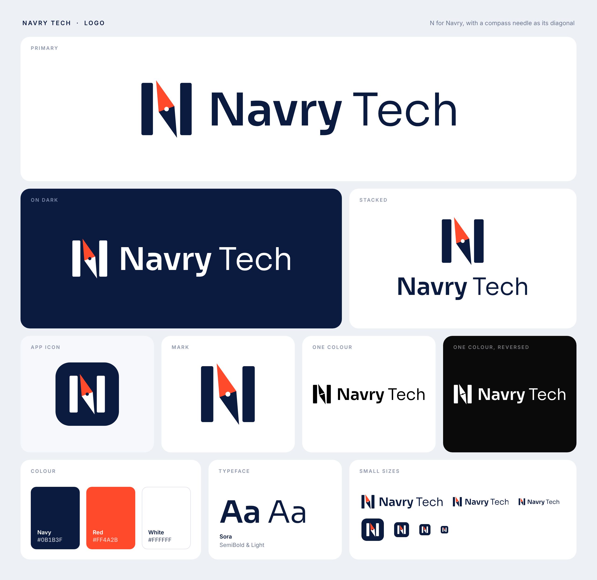

# Navry Tech logo

The mark is the letter **N** with a compass needle as its diagonal. The needle's north tip is red.

## Files

The SVGs in `svg/` are the masters. They scale to any size, and the lettering is converted to outlines, so no font needs to be installed. `png/` holds exports with transparent backgrounds for places that can't take SVG.

| File | Use it for |
| --- | --- |
| `svg/navry-tech-logo.svg` | The primary logo, on white or light backgrounds |
| `svg/navry-tech-logo-on-dark.svg` | The primary logo, on navy or other dark backgrounds |
| `svg/navry-tech-logo-stacked.svg` `svg/navry-tech-logo-stacked-on-dark.svg` | Square or narrow spaces |
| `svg/navry-tech-mark.svg` `svg/navry-tech-mark-on-dark.svg` | The N on its own, where the name already appears nearby |
| `svg/navry-tech-icon.svg` | App icon, profile picture, favicon |
| `svg/navry-tech-logo-black.svg` `svg/navry-tech-logo-white.svg` | One-colour jobs: single-ink print, engraving, stamps, watermarks |

| PNG | Size |
| --- | --- |
| `png/navry-tech-logo.png`, `png/navry-tech-logo-on-dark.png` | 2000 × 368 |
| `png/navry-tech-logo-stacked.png`, `png/navry-tech-logo-stacked-on-dark.png` | 1500 × 967 |
| `png/navry-tech-mark.png` | 894 × 1024 |
| `png/navry-tech-icon-512.png`, `png/navry-tech-icon-1024.png` | 512 × 512, 1024 × 1024 |

## Colours

| Name | Hex | RGB |
| --- | --- | --- |
| Navy | `#0B1B3F` | 11, 27, 63 |
| Red | `#FF4A2B` | 255, 74, 43 |
| White | `#FFFFFF` | 255, 255, 255 |

## Typeface

The wordmark is set in [Sora](https://fonts.google.com/specimen/Sora), which is free to use under the SIL Open Font License. "Navry" is SemiBold (weight 600) and "Tech" is weight 350, between Light and Regular. Sora is a good match for headings on a website or in documents.

## Using it

- Leave clear space on every side at least as tall as the capital N in "Navry".
- Below about 20 px tall, use the icon instead of the full logo.
- Use the files as they are: don't stretch, recolour, or re-type the name in another font.
